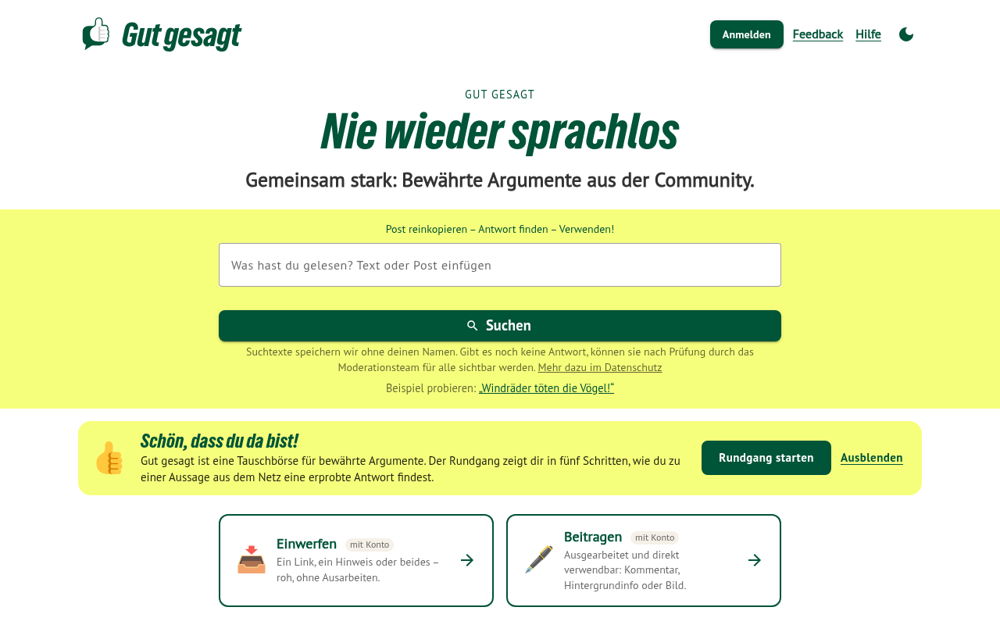
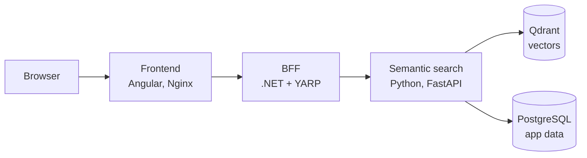

<p align="center">
  
</p>

<h1 align="center">Gut gesagt</h1>

<p align="center">
  <strong>Never lost for words again.</strong> Good replies to slogans and one-liners online, collected and improved by many.<br>
  <a href="https://gutgesagt.netzbegruenung.de">gutgesagt.netzbegruenung.de</a>
</p>

<p align="center">
  🇩🇪 <a href="README.md">Deutsche Fassung</a>
</p>

<p align="center">
  
</p>

"Gut gesagt" is German for "well said". The app itself is in German.

## 💬 What it is about

Under a post, someone writes a slogan like "Wind turbines kill the birds!". A good reply often
comes to mind only later. Gut gesagt helps you find one fast.

- **Replies for the people reading along.** A reply speaks to the undecided readers, not to the
  person who posted the slogan.
- **Short, medium or long.** Many replies come in several versions: short for chats and
  information stands, medium for the comment section, long with the reasoning.
- **In different tones.** Factual, humorous, personal or friendly.
- **With sources.** Background facts name where they come from, so every number can be checked.
- **Made by many.** People write the replies; others rate, use and improve them. Similarity,
  votes and usage decide which reply comes first, not an official line.
- **Free to use.** Whoever contributes puts their own wording under
  [CC0](https://creativecommons.org/publicdomain/zero/1.0/deed.en). Everyone may copy, adapt and
  post it without asking.

## 🧭 How it works

1. **Paste the slogan.** Copy the post or comment into the search field, or type it in.
2. **Find a reply.** Gut gesagt shows matching replies, even when the slogan is worded
   differently. Pick the length and tone that suit you.
3. **Use it.** Copy the reply or share it. Rate what helped you. That way others find the best
   replies faster.

Searching works without signing in. To write replies or drop in finds, you sign in with a
Netzbegrünung account.

## 🤝 Get involved

- **Content:** right in the app. If a reply is missing, write it yourself or drop in a link so
  that others can turn it into a reply.
- **Feedback and questions:** use the "Feedback" button in the app or write to
  [gutgesagt@netzbegruenung.de](mailto:gutgesagt@netzbegruenung.de).
- **Code:** development happens on Forgejo
  ([git.verdigado.com/Netzbegruenung/gutgesagt](https://git.verdigado.com/Netzbegruenung/gutgesagt)).
  GitHub ([netzbegruenung/gutgesagt](https://github.com/netzbegruenung/gutgesagt)) is a
  read-only mirror. How to get started: [CONTRIBUTING](.github/CONTRIBUTING.md).
- **Security vulnerabilities:** please do not report them publicly; follow
  [SECURITY](SECURITY.md).

## 🛠️ Technology



- **Frontend:** Angular, served by Nginx.
- **BFF** (Backend for Frontend): .NET with YARP, handles sign-in and forwards requests.
- **Semantic search:** Python with FastAPI. Qdrant stores the vectors, PostgreSQL the other data.
- **Own language models, own servers.** The search understands meaning, not just words, using
  multilingual E5 embeddings. An NLI model helps recognise when the same statement is worded
  differently. spaCy gives hints on form while you write. These specialised models run
  locally inside the service. A general-purpose language model would only be used where no
  specialised tool fits, and then on the project's own infrastructure, never with external
  providers. Search texts and contributions stay on the project's own servers, which is good for
  privacy.

### Quick start

Requirement: Docker with Docker Compose.

```bash
git clone https://github.com/netzbegruenung/gutgesagt.git gutgesagt
cd gutgesagt/mvp
docker compose -f docker-compose.dev.yml build
docker compose -f docker-compose.dev.yml up
```

The app then runs at [http://localhost:8080](http://localhost:8080). To sign in with the test
account, copy a configuration file before starting; how to do that and how to develop single
parts is in [CONTRIBUTING](.github/CONTRIBUTING.md).

### More documentation

| Topic | File |
|-------|------|
| What Gut gesagt is for and where its limits are (German) | [`docs/VISION.md`](docs/VISION.md) |
| Terms (German) | [`GLOSSARY.md`](GLOSSARY.md) |
| Architecture, environment variables | [`docs/ARCHITECTURE.md`](docs/ARCHITECTURE.md) |
| Developing and testing | [`docs/DEV_GUIDE.md`](docs/DEV_GUIDE.md), [`docs/DEV-SETUP.md`](docs/DEV-SETUP.md) |
| Operations and releases | [`docs/DEPLOYMENT.md`](docs/DEPLOYMENT.md) |
| State and direction | [`docs/STATUS.md`](docs/STATUS.md), [`docs/ROADMAP.md`](docs/ROADMAP.md), [milestones on Forgejo](https://git.verdigado.com/Netzbegruenung/gutgesagt/milestones) |

Everything else is in [`docs/`](docs/).

## 📄 License

The code is licensed under the [GNU Affero General Public License v3.0](LICENSE). Authors put
their own wording in the app under CC0.

The hand in the logo, favicon, seal badge and vote buttons is the "Thumbs up" emoji from
[Fluent Emoji](https://github.com/microsoft/fluentui-emoji) (MIT, Copyright Microsoft
Corporation), see [FLUENT-EMOJI-LIZENZ.txt](mvp/frontend/gutgesagt-frontend/public/marke/FLUENT-EMOJI-LIZENZ.txt).
The profile pictures are Fluent Emoji 3D as well, see
[public/avatars/FLUENT-EMOJI-LIZENZ.txt](mvp/frontend/gutgesagt-frontend/public/avatars/FLUENT-EMOJI-LIZENZ.txt).
