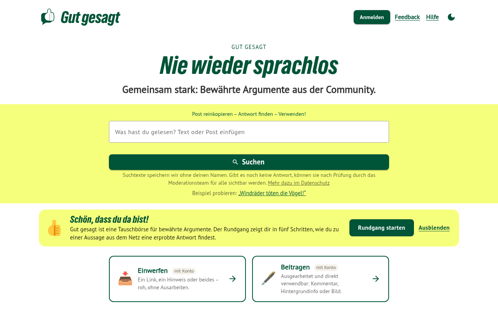
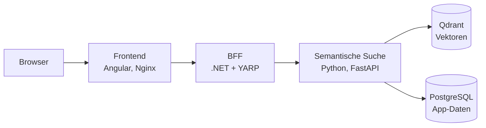

<p align="center">
  
</p>

<h1 align="center">Gut gesagt</h1>

<p align="center">
  <strong>Nie wieder sprachlos.</strong> Gute Antworten auf Sprüche aus dem Netz, gesammelt und verbessert von vielen.<br>
  <a href="https://gutgesagt.netzbegruenung.de">gutgesagt.netzbegruenung.de</a>
</p>

<p align="center">
  🇬🇧 <a href="README.en.md">English version</a>
</p>

<p align="center">
  
</p>

## 💬 Worum es geht

Unter einem Post steht ein Spruch wie „Windräder töten die Vögel!“. Eine gute Antwort fällt einem
oft erst später ein. Gut gesagt hilft, sie schnell zu finden.

- **Antworten für die Mitlesenden.** Eine Antwort richtet sich an die Unentschiedenen, die
  mitlesen, nicht an die Person, die den Spruch geschrieben hat.
- **Kurz, mittel oder lang.** Viele Antworten gibt es in mehreren Fassungen: kurz für Chat und
  Infostand, mittel für die Kommentarspalte, lang mit Begründung.
- **In verschiedenen Tönen.** Sachlich, humorvoll, persönlich oder freundlich.
- **Mit Quellen.** Hintergrundinfos nennen ihre Herkunft, damit jede Zahl nachprüfbar ist.
- **Von vielen gemacht.** Menschen schreiben die Antworten, andere bewerten, nutzen und
  verbessern sie. Welche Antwort oben steht, entscheiden Ähnlichkeit, Stimmen und Nutzung, keine
  offizielle Linie.
- **Frei verwendbar.** Wer etwas beiträgt, stellt die eigene Formulierung unter
  [CC0](https://creativecommons.org/publicdomain/zero/1.0/deed.de). Alle dürfen sie kopieren,
  anpassen und posten, ohne zu fragen.

## 🧭 So funktioniert's

1. **Spruch einfügen.** Kopiere den Post oder Kommentar in das Suchfeld, oder tippe ihn ab.
2. **Antwort finden.** Gut gesagt zeigt passende Antworten, auch wenn der Spruch anders
   formuliert ist. Wähle Länge und Ton, die zu dir passen.
3. **Verwenden.** Kopiere die Antwort oder teile sie. Bewerte, was dir geholfen hat. So
   finden andere die besten Antworten schneller.

Suchen geht ohne Anmeldung. Wer selbst Antworten schreibt oder Fundstücke einwirft, meldet sich
mit einem Konto der Netzbegrünung an.

## 🤝 Mitmachen

- **Inhalte:** direkt in der App. Fehlt eine Antwort, schreib sie selbst oder wirf einen Link
  ein, damit andere daraus eine Antwort machen.
- **Rückmeldung und Fragen:** über den Knopf „Feedback“ in der App oder per Mail an
  [gutgesagt@netzbegruenung.de](mailto:gutgesagt@netzbegruenung.de).
- **Code:** Entwickelt wird auf Forgejo
  ([git.verdigado.com/Netzbegruenung/gutgesagt](https://git.verdigado.com/Netzbegruenung/gutgesagt)).
  GitHub ([netzbegruenung/gutgesagt](https://github.com/netzbegruenung/gutgesagt)) ist ein
  Spiegel nur zum Lesen. Wie du einsteigst: [CONTRIBUTING](.github/CONTRIBUTING.md) (englisch).
- **Sicherheitslücken:** bitte nicht öffentlich melden, sondern wie in [SECURITY](SECURITY.md)
  beschrieben.

## 🛠️ Technik



- **Frontend:** Angular, ausgeliefert über Nginx.
- **BFF** (Backend for Frontend): .NET mit YARP, kümmert sich um Anmeldung und leitet Anfragen weiter.
- **Semantische Suche:** Python mit FastAPI. Qdrant speichert die Vektoren, PostgreSQL die übrigen Daten.
- **Eigene Sprachmodelle, eigene Server.** Die Suche versteht Bedeutung, nicht nur Wörter: mit
  mehrsprachigen E5-Embeddings. Ein NLI-Modell hilft zu erkennen, wenn dieselbe Aussage anders
  formuliert ist. spaCy gibt beim Schreiben Hinweise zur Form. Diese spezialisierten Modelle
  laufen lokal im Dienst. Ein allgemeines Sprachmodell käme nur dort zum Einsatz, wo kein
  Spezialwerkzeug passt, und dann auf eigener Infrastruktur, nie bei externen Anbietern. So
  bleiben Suchtexte und Beiträge auf den eigenen Servern, gut für den Datenschutz.

### Schnellstart

Voraussetzung: Docker mit Docker Compose.

```bash
git clone https://github.com/netzbegruenung/gutgesagt.git gutgesagt
cd gutgesagt/mvp
docker compose -f docker-compose.dev.yml build
docker compose -f docker-compose.dev.yml up
```

Die App läuft dann unter [http://localhost:8080](http://localhost:8080). Für die Anmeldung mit
dem Testkonto vor dem Start eine Konfigurationsdatei kopieren; wie das geht und wie man einzelne
Teile entwickelt, steht in [CONTRIBUTING](.github/CONTRIBUTING.md).

### Mehr Doku

| Thema | Datei |
|-------|-------|
| Wofür Gut gesagt da ist und wo seine Grenzen liegen | [`docs/VISION.md`](docs/VISION.md) |
| Begriffe | [`GLOSSARY.md`](GLOSSARY.md) |
| Architektur, Umgebungsvariablen | [`docs/ARCHITECTURE.md`](docs/ARCHITECTURE.md) |
| Entwickeln und testen | [`docs/DEV_GUIDE.md`](docs/DEV_GUIDE.md), [`docs/DEV-SETUP.md`](docs/DEV-SETUP.md) |
| Betrieb und Releases | [`docs/DEPLOYMENT.md`](docs/DEPLOYMENT.md) |
| Stand und Richtung | [`docs/STATUS.md`](docs/STATUS.md), [`docs/ROADMAP.md`](docs/ROADMAP.md), [Meilensteine auf Forgejo](https://git.verdigado.com/Netzbegruenung/gutgesagt/milestones) |

Alles Weitere liegt unter [`docs/`](docs/).

## 📄 Lizenz

Der Code steht unter der [GNU Affero General Public License v3.0](LICENSE). Ihre eigenen
Formulierungen in der App stellen die Autor:innen unter CC0.

Die Hand in Logo, Favicon, Siegel und Bewertungsknöpfen ist das Emoji „Thumbs up“ aus
[Fluent Emoji](https://github.com/microsoft/fluentui-emoji) (MIT, Copyright Microsoft
Corporation), siehe [FLUENT-EMOJI-LIZENZ.txt](mvp/frontend/gutgesagt-frontend/public/marke/FLUENT-EMOJI-LIZENZ.txt).
Auch die Profilbilder sind Fluent Emoji 3D, siehe
[public/avatars/FLUENT-EMOJI-LIZENZ.txt](mvp/frontend/gutgesagt-frontend/public/avatars/FLUENT-EMOJI-LIZENZ.txt).
